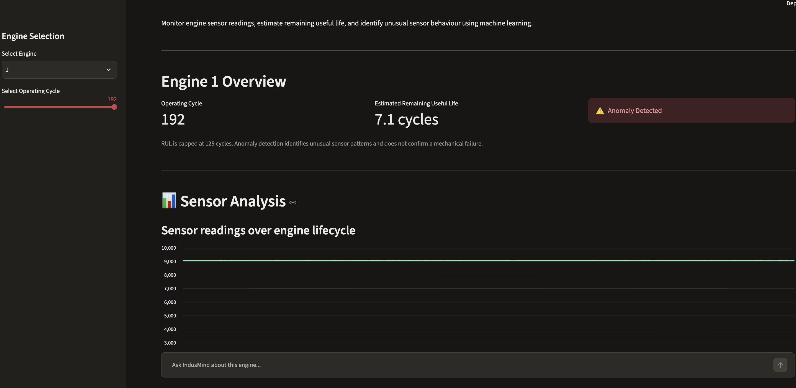
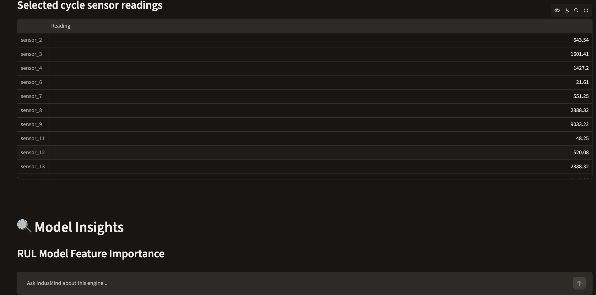
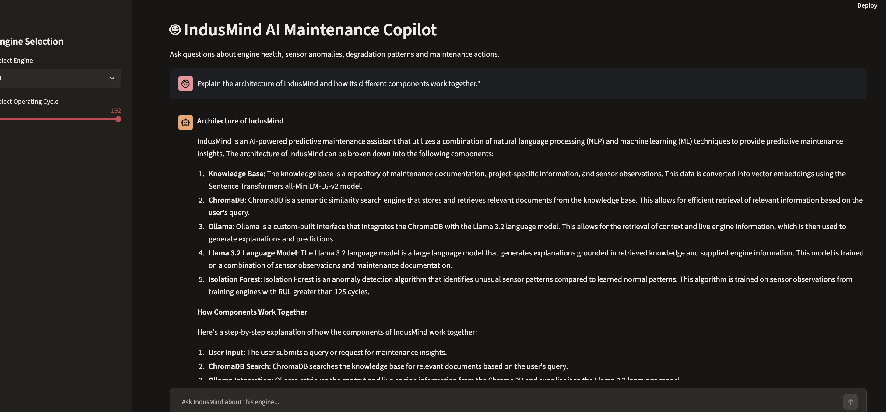

# IndusMind — Industrial Predictive Maintenance & AI Copilot

An end-to-end machine learning and Generative AI application for predicting turbofan engine degradation, estimating Remaining Useful Life (RUL), detecting abnormal sensor behaviour, and providing AI-powered maintenance insights.

## Project Overview

Unexpected equipment failures can cause operational downtime, increased maintenance costs, and safety risks.

**IndusMind** is a predictive maintenance prototype that uses historical engine sensor data and machine learning to estimate how much useful operating life an engine has remaining.

It combines predictive machine learning with a Retrieval-Augmented Generation (RAG) based AI Maintenance Copilot to make model insights easier to understand.

The project uses NASA's C-MAPSS turbofan engine degradation dataset.

## Key Features

- **Remaining Useful Life (RUL) Prediction:** Estimates the remaining operating cycles of an engine using sensor readings.
- **Predictive Machine Learning:** Uses a Gradient Boosting Regressor to predict engine degradation.
- **Anomaly Detection:** Uses Isolation Forest to identify unusual sensor behaviour.
- **AI Maintenance Copilot:** Answers maintenance-related questions using Llama 3.2 and Retrieval-Augmented Generation.
- **Context-Aware Insights:** Provides the AI copilot with live engine information, including predicted RUL, anomaly status, and sensor readings.
- **Feature Importance Analysis:** Identifies which sensor readings contribute most to the prediction.
- **Interactive Dashboard:** Built using Streamlit to explore engine health and model predictions.

## Technology Stack

 Category             | Technologies 

 Programming Language | Python 
 Data Analysis        | Pandas, NumPy 
 Data Visualization   | Matplotlib, Streamlit 
 Machine Learning     | Scikit-learn 
 Model Persistence    | Joblib 
 Anomaly Detection    | Isolation Forest 
 Predictive Modeling  | Gradient Boosting Regressor 
 LLM                  | Llama 3.2 
 RAG Framework        | Custom RAG pipeline 
 Vector Database      | ChromaDB 
 Embeddings           | Sentence Transformers (all-MiniLM-L6-v2) 

## Machine Learning Approach

### 1. Data Preprocessing
- Loaded and explored the NASA C-MAPSS FD001 dataset.
- Assigned engine IDs and operating cycle information.
- Generated Remaining Useful Life (RUL) labels.
- Identified and removed six low-variance sensor features.
- Split training and validation data by engine to avoid data leakage.

### 2. Remaining Useful Life Prediction

A Gradient Boosting Regressor was trained to estimate engine Remaining Useful Life.

The target RUL was capped at 125 cycles to reduce the influence of early-life operating periods.

**Validation Results:**

 Metric                         | Result 
 Mean Absolute Error (MAE)      | 10.80 cycles 
 Root Mean Squared Error (RMSE) | 15.53 cycles 
 R² Score                       | 0.8615 

These results are from the engine-level validation split used in this project.

### 3. Feature Importance

The model identified the following as its most influential features:

 Feature    | Importance 

 Sensor 11  | 32.44% 
 Cycle      | 23.90% 
 Sensor 4   | 16.85% 
 Sensor 12  | 7.87% 
 Sensor 9   | 5.23% 

### 4. Anomaly Detection

An Isolation Forest model was trained using healthy operating observations to identify unusual sensor patterns.

An anomaly flag indicates unusual behaviour, not a confirmed engine failure.

## Generative AI: AI Maintenance Copilot

IndusMind integrates a local LLM with a Retrieval-Augmented Generation (RAG) pipeline.

### Architecture

1. The user submits a maintenance-related question through the Streamlit dashboard.
2. Sentence Transformers converts the question into an embedding.
3. ChromaDB retrieves relevant maintenance knowledge and project documentation.
4. The retrieved context is passed to Llama 3.2 through Ollama.
5. The LLM generates a context-aware response.
6. Live engine information is also provided to the copilot when available.

### Components

- **LLM:** Llama 3.2
- **Model Runtime:** Ollama
- **Embedding Model:** all-MiniLM-L6-v2
- **Vector Database:** ChromaDB
- **Retrieval:** Semantic similarity search

The copilot can answer questions about sensor importance, model performance, anomaly detection, predictive maintenance concepts, and the currently selected engine.

## Project Structure

```text
IndusMind/
│
├── app.py
├── rag_engine.py
├── requirements.txt
├── README.md
│
├── data/
│   └── processed/
│       └── engine_data.csv
│
├── models/
│   ├── rul_model.pkl
│   ├── feature_columns.pkl
│   ├── anomaly_model.pkl
│   └── anomaly_features.pkl
│
├── notebooks/
│   └── 01_data_exploration.ipynb
│
└── maintenance_db/       # Generated locally
```

## Installation and Setup

### 1. Clone the Repository

```bash
git clone YOUR_GITHUB_REPOSITORY_URL
cd IndusMind
```

### 2. Create a Virtual Environment

```bash
python3 -m venv .venv
source .venv/bin/activate
```

### 3. Install Dependencies

```bash
python3 -m pip install -r requirements.txt
```

### 4. Install Ollama

Download Ollama from:

https://ollama.com/

Pull the Llama 3.2 model:

```bash
ollama pull llama3.2
```

Make sure Ollama is running before using the AI copilot.

### 5. Rebuild the RAG Knowledge Base

```bash
python3 rag_engine.py
```

This initializes the ChromaDB collection and loads the project knowledge documents.

### 6. Run the Application

```bash
python3 -m streamlit run app.py
```

Open the local URL displayed in your terminal.

## Dataset

**NASA C-MAPSS Turbofan Engine Degradation Dataset — FD001**

Source: [NASA Prognostics Center of Excellence Data Repository](https://www.nasa.gov/intelligent-systems-division/discovery-and-systems-health/pcoe/pcoe-data-set-repository/)

The FD001 dataset contains simulated run-to-failure sensor measurements from turbofan engines.

- 100 training engines
- 20,631 training observations
- 21 sensor measurements
- 3 operational settings

The processed dataset and trained models are included in this project repository. The original raw dataset is not required to run the dashboard.

## Limitations

- The project uses simulated turbofan engine data rather than live industrial equipment.
- RUL predictions are capped at 125 cycles.
- Anomaly detection identifies unusual patterns and does not confirm physical failures.
- Model performance on this dataset does not guarantee performance on real-world machinery.
- The application is an educational and portfolio prototype, not a certified industrial maintenance or safety system.

## Future Improvements

- Integrate real-time industrial IoT sensor streams.
- Experiment with advanced time-series forecasting models.
- Improve model explainability using SHAP.
- Expand the maintenance knowledge base.
- Add automated maintenance alerts and reporting.
- Evaluate performance on additional engine degradation datasets.


## Application Screenshots

### 1. Predictive Maintenance Dashboard
Displays engine selection, predicted Remaining Useful Life (RUL), and anomaly detection status.



### 2. Sensor Readings & Feature Importance
Visualizes sensor behaviour and identifies the most influential features in the RUL prediction model.



### 3. AI Maintenance Copilot
An AI-powered assistant using RAG and Llama 3.2 to answer maintenance-related questions with engine context.




**IndusMind | Predictive Maintenance + Machine Learning + Generative AI**